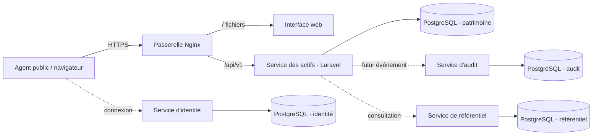
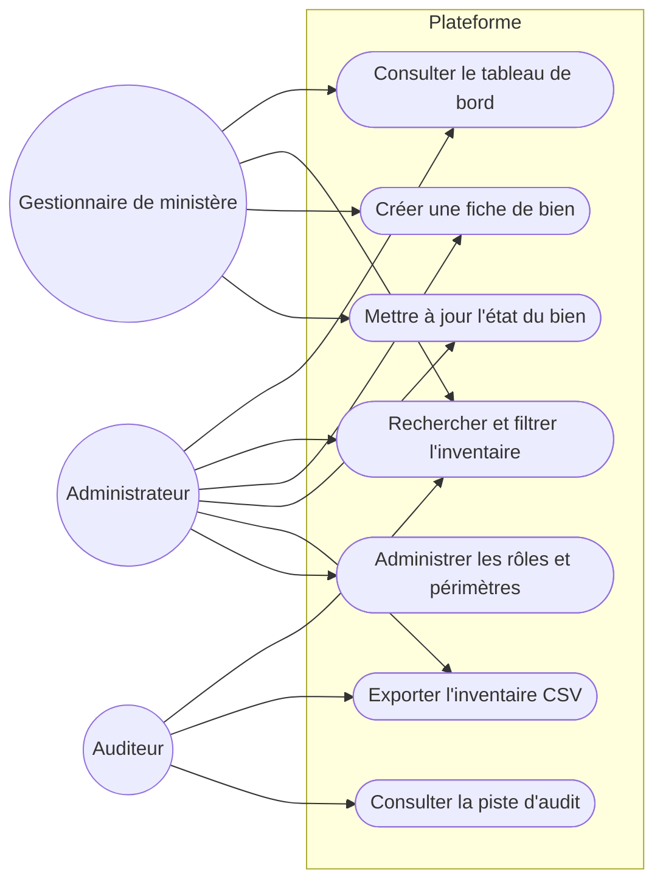
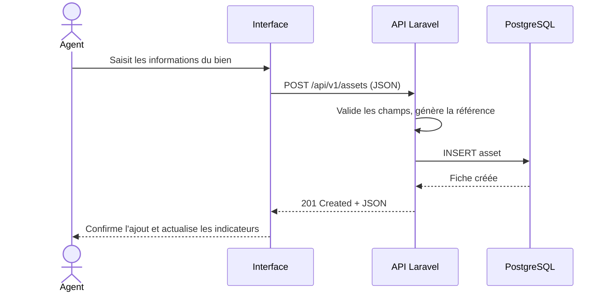

# Fiche technique et architecture

## Fiche technique

| Élément | Choix |
| --- | --- |
| Produit | Patrimoine Togo — démonstrateur de gestion d'actifs publics |
| Interface | HTML sémantique, CSS responsive, JavaScript sans dépendance de compilation |
| Backend | Laravel 12, PHP 8.3 dans le conteneur |
| API | REST JSON, version `/api/v1`, validation Laravel |
| Données | PostgreSQL 16, migrations versionnées, identifiants séquentiels et référence métier unique |
| Déploiement local | Docker Compose : Nginx, API Laravel, PostgreSQL |
| Langue et devise | Français, FCFA/XOF |
| Compatibilité | Navigateurs modernes sur ordinateur et mobile |
| Démonstration | Données entièrement fictives, sans compte d'accès configuré |

## Architecture cible en services

Le dépôt met en œuvre le service de gestion des actifs, une passerelle HTTP Nginx et PostgreSQL. Les domaines sont séparés dans le modèle cible pour éviter un monolithe métier. Les services identité, référentiel et audit sont des frontières d'architecture documentées ; ils ne sont pas encore des conteneurs applicatifs livrés. C'est un MVP honnête de l'architecture microservices, pas un système ministériel déjà industrialisé.



**Choix de déploiement MVP :** le Compose local contient trois conteneurs : Nginx, le service Laravel et PostgreSQL. En production, les domaines identité, référentiel et audit doivent devenir des services indépendamment déployables avec leurs propres bases, politiques d'accès et interfaces de contrat. L'architecture cible est représentée par le diagramme, alors que le périmètre livré est indiqué explicitement.

## Modèle de données (UML)

```mermaid
classDiagram
  class Asset {
    +id: bigint
    +reference: string unique
    +name: string
    +category: string
    +type: string
    +ministry: string
    +location: string
    +status: enum
    +acquired_at: date
    +value_xof: integer
    +description: text
    +created_at: datetime
    +updated_at: datetime
  }
  class User <<service futur>> {
    +id: UUID
    +name: string
    +email: string
    +role: string
    +administrative_scope: string
  }
  class Movement <<service futur>> {
    +id: UUID
    +asset_reference: string
    +from_location: string
    +to_location: string
    +reason: string
    +created_by: UUID
    +occurred_at: datetime
  }
  class AuditEvent <<service futur>> {
    +id: UUID
    +actor_id: UUID
    +entity_reference: string
    +action: string
    +before: JSON
    +after: JSON
    +occurred_at: datetime
  }
  User "1" --> "0..*" Movement : initie
  Asset "1" --> "0..*" Movement : historique
  User "1" --> "0..*" AuditEvent : acteur
```

`Asset` est implémenté par migration Laravel. `User`, `Movement` et `AuditEvent` représentent les services de la cible à construire ; les références entre services sont des identifiants métier/UUID plutôt que des clés étrangères PostgreSQL inter-bases.

## Cas d'utilisation (UML)



Cas de création :



## API exposée

| Méthode | Route | Usage |
| --- | --- | --- |
| GET | `/api/v1/health` | Vérifier que le service répond |
| GET | `/api/v1/summary` | Résumé agrégé du parc |
| GET | `/api/v1/assets?q=&status=&category=&per_page=` | Recherche et pagination |
| POST | `/api/v1/assets` | Créer une fiche validée |
| GET | `/api/v1/assets/{id}` | Lire une fiche |
| PUT/PATCH | `/api/v1/assets/{id}` | Modifier une fiche |
| DELETE | `/api/v1/assets/{id}` | Supprimer (démonstration seulement ; désactivation recommandée en vrai) |

Toutes les opérations d'écriture devront être protégées par authentification et autorisation avant une mise en service. L'API de démonstration n'implémente pas encore ces contrôles : elle ne doit pas recevoir de données réelles.

## Sécurité et exploitation à compléter avant mise en production

Authentification OIDC/SSO, rôles et périmètres administratifs, contrôle d'accès à chaque requête, TLS, rotation des secrets, journal d'audit à conservation contrôlée, limitation de débit, sauvegarde/restauration testées, logs centralisés, supervision, antivirus des pièces jointes, gestion des vulnérabilités et politique de conservation. Aucun de ces contrôles ne doit être considéré comme validé par le prototype.
