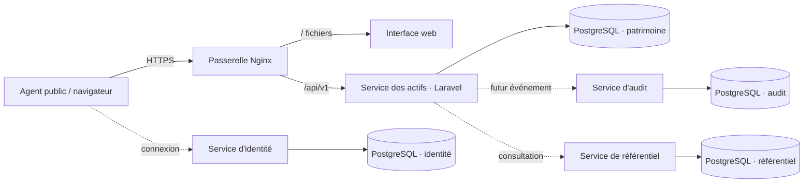
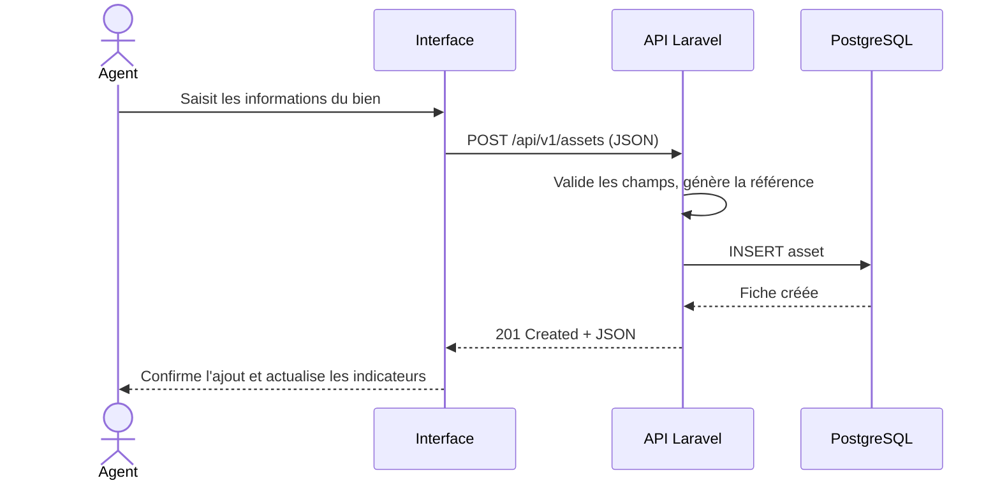

# Fiche technique et architecture

## Fiche technique

| Élément | Choix |
| --- | --- |
| Produit | Patrimoine Togo — démonstrateur de gestion d'actifs publics |
| Interface | HTML sémantique, CSS responsive, JavaScript sans dépendance de compilation |
| Backend | Laravel 12, PHP 8.3 dans le conteneur |
| API | REST JSON, version `/api/v1`, validation Laravel |
| Données | PostgreSQL 16, migrations versionnées, biens, services administratifs et mouvements historisés |
| Déploiement local | Docker Compose : Nginx, API Laravel, PostgreSQL |
| Langue et devise | Français, FCFA/XOF |
| Compatibilité | Navigateurs modernes sur ordinateur et mobile |
| Démonstration | Données entièrement fictives, sans compte d'accès configuré |

## Architecture cible en services

Le dépôt met en œuvre une passerelle HTTP Nginx, une API Laravel et PostgreSQL. Le service Laravel expose des modules versionnés pour les actifs, le répertoire des services, les mouvements et les rapports. Cette première tranche reste déployée dans un même conteneur applicatif pour garder un démarrage pédagogique simple ; elle n'est donc pas encore un ensemble de microservices indépendamment déployables. Les services identité et audit restent des frontières de la cible à construire.



**Choix de déploiement MVP :** le Compose local contient trois conteneurs : Nginx, le service Laravel et PostgreSQL. En production, les domaines identité, référentiel et audit doivent devenir des services indépendamment déployables avec leurs propres bases, politiques d'accès et interfaces de contrat. L'architecture cible est représentée par le diagramme, alors que le périmètre livré est indiqué explicitement.

## Modèle de données (UML)

```mermaid
classDiagram
  class Asset {
    +id: bigint
    +reference: string unique
    +name: string
    +category: string
    +type: string
    +ministry: string
    +location: string
    +status: enum
    +acquired_at: date
    +value_xof: integer
    +description: text
    +created_at: datetime
    +updated_at: datetime
  }
  class GovernmentService {
    +id: bigint
    +name: string unique
    +ministry: string
    +region: string
    +prefecture: string
    +address: string
    +manager: string
    +contact: string
    +is_active: boolean
  }
  class Movement {
    +id: bigint
    +reference: string unique
    +asset_id: bigint
    +type: enum
    +from_ministry: string
    +to_ministry: string
    +from_location: string
    +to_location: string
    +occurred_at: date
    +reason: string
    +recorded_by: string
  }
  class User <<service futur>> {
    +id: UUID
    +name: string
    +email: string
    +role: string
    +administrative_scope: string
  }
  class AuditEvent <<service futur>> {
    +id: UUID
    +actor_id: UUID
    +entity_reference: string
    +action: string
    +before: JSON
    +after: JSON
    +occurred_at: datetime
  }
  GovernmentService "1" .. "0..*" Asset : rattachement par ministère
  User "1" --> "0..*" Movement : initie (cible authentifiée)
  Asset "1" --> "0..*" Movement : historique
  User "1" --> "0..*" AuditEvent : acteur
```

`Asset`, `GovernmentService` et `Movement` sont implémentés par migrations Laravel. Le rattachement service/actif utilise actuellement le libellé du ministère dans la fiche du bien ; les mouvements conservent l'origine et la destination et sont enregistrés dans une transaction avec la mise à jour de l'actif. `User` et `AuditEvent` restent des éléments de cible à construire.

## Cas d'utilisation (UML)


Cas de création :



## API exposée

| Méthode | Route | Usage |
| --- | --- | --- |
| GET | `/api/v1/health` | Vérifier que le service répond |
| GET | `/api/v1/summary` | Résumé agrégé du parc |
| GET | `/api/v1/assets?q=&status=&category=&per_page=` | Recherche et pagination |
| POST | `/api/v1/assets` | Créer une fiche validée |
| GET | `/api/v1/assets/{id}` | Lire une fiche |
| PUT/PATCH | `/api/v1/assets/{id}` | Modifier une fiche |
| DELETE | `/api/v1/assets/{id}` | Supprimer (démonstration seulement ; désactivation recommandée en vrai) |
| GET/POST | `/api/v1/services` | Lister et créer les services de l'État |
| PUT/PATCH | `/api/v1/services/{id}` | Modifier un service ou son statut |
| GET/POST | `/api/v1/movements` | Consulter l'historique et enregistrer une opération |
| GET | `/api/v1/reports/summary` | Produire des agrégats sur l'inventaire filtré |

La carte est un schéma indicatif fondé sur la détection du nom des villes dans la localisation ; aucun géocodage précis n'est livré. Toutes les opérations d'écriture devront être protégées par authentification et autorisation avant une mise en service. L'API de démonstration n'implémente pas encore ces contrôles : elle ne doit pas recevoir de données réelles.

## Sécurité et exploitation à compléter avant mise en production

Authentification OIDC/SSO, rôles et périmètres administratifs, contrôle d'accès à chaque requête, TLS, rotation des secrets, journal d'audit à conservation contrôlée, limitation de débit, sauvegarde/restauration testées, logs centralisés, supervision, antivirus des pièces jointes, gestion des vulnérabilités et politique de conservation. Aucun de ces contrôles ne doit être considéré comme validé par le prototype.
